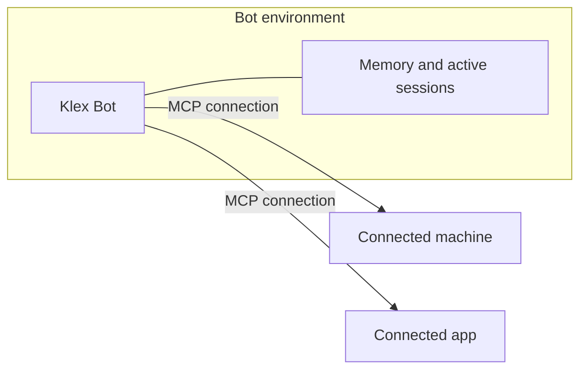

A Klex Bot is an autonomous agent with its own identity and memory. It runs in a Bot environment and works in other environments connected through MCP (Model Context Protocol).

The distinction matters: the Bot's own environment keeps it running and manages its memory. Its work happens in connected machines and apps, not inside that environment.

## Where the Bot runs

The Bot environment manages the Bot's active sessions and memory. It keeps the Bot running, but is not a workspace where the Bot carries out its work.

You can use a Cloud-hosted Bot or run a Bot in your own environment. Klex recommends Cloud hosting; a self-hosted Bot can also be enrolled in Klex Cloud. Cloud enrollment is not technically required for a self-hosted Bot, although the standalone experience is less complete. See [hosted vs. self-hosted](/cloud/hosted-vs-local).

## How the Bot works with machines and apps

A Bot connects to an MCP server to reach an external environment. That environment can be a full machine or an app such as GitHub or Google Workspace. A machine is also connected through MCP.

For most MCPs, the Bot acts through an account or identity of its own. That identity is configured per Bot and can have permissions and access grants. See [Connections](/bot/concepts/brain-and-computers) for the connection and access model.

## What the Bot remembers

Klex Bot Memory currently stores skills and learnings. Chats and memory are stored in the Bot's data directory. See [Memory](/bot/concepts/memory) for what is known today and [the data directory](/bot/concepts/data-directory) for storage and administrator access.

## Next steps

- [Create a Bot](/bot/quickstart)
- [Connect machines and apps](/bot/concepts/brain-and-computers)
- [Explore Memory](/bot/concepts/memory)
