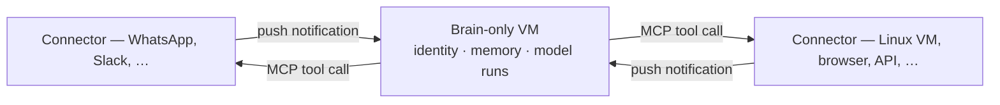

> **How do Klex Bots work?**

A Klex Bot is one durable agent: a **brain** — identity, memory, and personality — that runs on its own small virtual machine and reaches the outside world only through **Connectors**: MCP servers like WhatsApp, Slack, or Telegram for talking, or a Linux VM, browser, or API for working. You talk to one coherent actor through any Connector; the machinery underneath — model runs, context windows, tool calls — stays private to the bot.

## The brain: one identity, many thoughts

The brain is the Klex Bot: its identity — the [soul](/bot/concepts/soul) — its memory, its configuration, and the orchestration that ties them together. It never runs on the machines it works with — it lives in its own small, durable VM and reaches outward from there.

Model conversations are the Klex Bot's thoughts. Many can run at once, starting and stopping freely — like background processes in a brain. The Klex Bot borrows a page from how human consciousness is thought to work: in [Global Workspace Theory](https://en.wikipedia.org/wiki/Global_workspace_theory), most processing happens in parallel outside of awareness, while a single "workspace" holds the spotlight and drives behavior. A Klex Bot works the same way: background thoughts filter incoming signals, consolidate memories, and refine skills, while exactly one line of thought at a time holds the stage and acts on the outside world.

That is the point of the design. All that parallelism exists so that, from the outside, there is only ever a **single stream of consciousness**: one coherent voice that knows who it is and stays the same actor whether you talk to it on WhatsApp today or on Slack next week. And the background thoughts are what keep that stream smooth — while you chat, they quietly write down what matters, update what the Klex Bot knows, and sharpen how it works, so the next conversation starts a little smarter than the last without ever interrupting the one you're having.

You never see or manage any of this. There are no chats to babysit and no context windows to juggle — the Klex Bot shows you only its behavior.

## The body: Connectors

Everything outside the brain is a **Connector**, and every Connector is an MCP server. Talking and working go through the same mechanism: WhatsApp, Slack, Telegram, and local chat are Connectors — and so are a disposable Linux VM for writing code, a browser, or an external API. From the brain's point of view there is no difference between them, only tools to call and notifications to receive.

- **Senses:** whatever a Connector reports back arrives as a *push notification*. The Connector wakes the brain; the brain decides whether and how to respond.
- **Actions:** the brain acts by *calling MCP tools* on a Connector — sending a reply on WhatsApp, running a shell command in a VM, hitting an API endpoint.

Text a model writes is not automatically a message. A reply only reaches you when the brain decides to send it through the Connector you're talking on — raw model output stays internal unless the Klex Bot acts with it.

## Where the brain runs

The brain and the computers it uses are deliberately split. The brain-only VM holds everything durable — identity, memory, config — and stays small; the machines it works with hold everything disposable. Need to write code? Connect a fresh Linux VM. Done with it? Throw it away — the brain keeps its state.

This split is an architectural rule, and it applies strictly to cloud-hosted bots. If you run a Klex Bot fully locally, we recommend keeping the same separation — a dedicated small VM for the brain, external machines for the work — although a local setup doesn't enforce it.

## Memory: written down, not replayed

Memory lives above individual model runs. It preserves identity, decisions, tasks, and useful history across runs and Connectors — as plain Markdown files in the Klex Bot's data directory. A transcript of a model conversation is *input* to memory, not memory itself: the Klex Bot consolidates what matters into durable notes and lets the rest go.

Because memory is plain files, it is inspectable, portable, and yours — see [Memory](/bot/concepts/memory) for how remembering works, and [The brain and the computers](/bot/concepts/brain-and-computers) for the hosting split in detail.
