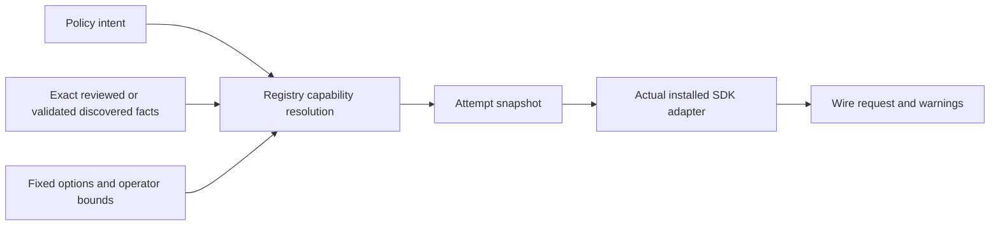

# Effort control evidence and contract

Status: implementation baseline, reviewed 2026-11-05. No live inference probes. API acceptance, wire serialization, semantic application, and task quality are separate claims. A reasoning capability boolean is never enough to choose an effort value.

## Shadow rollout and trace review

Absent effort configuration now selects runtime shadow mode in default sessions; explicit `effort.mode: off` disables it. No persisted schema/default is changed. Automatic mode remains explicit. Shadow classification can add Instinct cost, but never changes main-model reasoning/provider options. It requires Instinct to run; no explicitly selected Instinct model means the effort rubric is skipped and the baseline decision is marked classification-unavailable.

Inspect the `step.effort` event on each step span. `effort.requested` is the stateful policy recommendation; `effort.effective` is the hypothetical native mapping, **not** the setting used in shadow generation. `effort.applied` is false in shadow. Provider/model identity, capability status, resolution reason and evidence source/reference distinguish controlled profiles from unknown/fixed settings.

`effort.policy.*` fields expose desired (stateless) tier, previous active tier, objective reset, lower-progress count, resolution-seen state, classification availability, and the demand/failure/consequence/missing-evidence/resolved/progress rubric answers. Use these to inspect escalations, prolonged holds and decay. They contain no prompt text or chain-of-thought. The event describes a proposed decision before generation, not proof the state was committed or the task succeeded; inspect the containing step's outcome and linked Instinct/generation spans for failures, usage and latency. Shadow outcomes cannot establish counterfactual savings or quality.

## Inventory

All 27 entries in `providers/providers.ts` are accounted for. `compatible` below means the installed OpenAI-compatible SDK, with the provider type as option namespace (and `openaiCompatible` as fallback). Native options take precedence over portable `reasoning`. Unknown does not mean unsupported.

| Type | Class | Actual adapter / namespace | Control evidence and limits |
| --- | --- | --- | --- |
| openai | direct | OpenAI Responses / openai; audio uses Chat | Model-specific `reasoning.effort`; no universal enum/default/off support. Exact verified generations only. |
| anthropic | direct | Anthropic Messages / anthropic | `output_config.effort` and `thinking`; adaptive and budget generations differ. |
| google-gemini | direct | Google GenerateContent / google | `generationConfig.thinkingConfig`; do not copy Interactions tables into this transport. |
| google-vertex | hosted | Vertex GenerateContent / vertex | Same model-generation caution; project, region and model identity matter. |
| amazon-bedrock | hosted | Bedrock Converse / bedrock | `reasoningConfig` is model-family specific. Claude Messages documentation alone does not prove Converse encoding. |
| azure-openai | hosted | Azure Responses / openai | Deployment names opaque; require exact deployment declaration rather than guessing underlying GPT model. |
| openrouter | gateway | compatible / openrouter | `reasoning` object; `/models` exposes model-specific supported efforts and mandatory/default flags. Routing can change. |
| moonshot | direct | compatible / moonshot | Model-specific switches/efforts; no automatic generation-wide rule without exact evidence. |
| alibaba-qwen | direct | compatible / alibaba-qwen | `enable_thinking`, optional `thinking_budget`; hybrid and thinking-only generations differ. |
| deepseek | direct | compatible / deepseek | Current guide: low/high/max and thinking switch; older reasoner/chat aliases not assumed equivalent. |
| zai | direct | compatible / zai | `thinking.type`, generation-specific forced thinking and preserved-history requirements. |
| minimax | direct | compatible / minimax | Model-specific, newer always-thinking generations cannot accept off. |
| xiaomi-mimo | direct | compatible / xiaomi-mimo | Unknown: official docs rendered a shell; no fabricated profile. |
| mistral | direct | compatible / mistral | `reasoning_effort`; small-2603 and medium-3-5 none/high, large-4-0 low/medium/high. Response chunk support needs separate validation. |
| xai | direct | compatible / xai | Generation-specific effort; multi-agent effort is not ordinary depth. |
| glm-coding-plan | subscription | compatible / glm-coding-plan | Verify exact plan endpoint; do not inherit standard Z.ai behavior blindly. |
| minimax-coding-plan | subscription | compatible / minimax-coding-plan | Verify exact plan endpoint/model. |
| opencode-go | gateway | compatible / opencode-go | Routed model and endpoint contract, unknown by default. |
| opencode-zen | gateway | compatible / opencode-zen | Routed model and endpoint contract, unknown by default. |
| chatgpt-codex-subscription | subscription | Open Responses | String reasoningEffort; subscription model availability/levels need independent evidence. |
| chat-completions | custom protocol | compatible / chat-completions | Protocol supports `reasoning_effort`; endpoint may reject/ignore it. Tentative only when explicitly enabled. |
| responses | custom protocol | Open Responses / responses | `reasoning.effort`; native string override, not guaranteed endpoint support. |
| anthropic-messages | custom protocol | Anthropic / anthropic | Endpoint implementation unknown; don't infer exact Claude support from ID alone. |
| google-generative | custom protocol | Google / google | Endpoint implementation unknown; don't infer model controls from ID alone. |
| ollama | local daemon | compatible / ollama | `/api/show` thinking values/default can contain booleans or strings; daemon version matters. |
| typesafe-ai | evaluation-only | TypeSafe evaluation | Not applicable to main-model generation. |
| vercel-ai-gateway | gateway | native AI SDK gateway | Portable reasoning and routed-provider options; no universal routed-model guarantee. |

For unknown entries, defaults, disable support, budget/output relationships, and tool/history constraints are deliberately **unknown**, not inferred from names. Existing configured options remain valid pass-through. Automatic overrides require an exact reviewed profile, validated discovery, or an explicit tentative policy. No paid discovery or validation is triggered by effort resolution.

## Authoritative evidence

Links identify the reviewed source; upstream content can change. Revalidate exact models on adapter upgrades.

- [OpenAI reasoning](https://developers.openai.com/api/docs/guides/reasoning): “Supported values are model-dependent”; lower effort favors speed/token cost. `none` is rejected by some newer generations. Responses and Chat differ for tool support.
- [Anthropic effort](https://platform.claude.com/docs/en/build-with-claude/effort): “Thinking counts toward max_tokens”; effort is not only a thinking budget. Some generations reject disabled thinking; some support budgets. Top-level effort changes can affect caching. No broad Claude-family inference.
- [Gemini thinking](https://ai.google.dev/gemini-api/docs/thinking): current examples use Interactions. [Vertex thinking](https://cloud.google.com/vertex-ai/generative-ai/docs/thinking) documents GenerateContent `thinkingConfig`, levels and budgets; budget is deprecated for Gemini 3+. Model-specific minimum/off constraints apply.
- [Bedrock Claude thinking](https://docs.aws.amazon.com/bedrock/latest/userguide/claude-messages-extended-thinking.html): older budgets must be below output limits (interleaving exceptions exist); newer generations may reject manual/disabled thinking. This is not universal Converse evidence.
- [OpenRouter reasoning](https://openrouter.ai/docs/guides/best-practices/reasoning-tokens) and [live models catalog](https://openrouter.ai/api/v1/models): observed `reasoning.supported_efforts`, `mandatory`, `default_enabled`, `default_effort`. Example catalog values included low/high/none. Missing effort list does not establish a discrete range. Validate bounded values, not arbitrary remote request fields.
- [Ollama thinking](https://docs.ollama.com/capabilities/thinking): `/api/show` returns `thinking.values` and `default`; values can be booleans or model-defined strings. [Compatibility](https://docs.ollama.com/api/openai-compatibility) documents named effort aliases. Do not turn a discovered `thinking` capability boolean into a level list.
- [DeepSeek thinking](https://api-docs.deepseek.com/guides/thinking_mode): current guide maps minimal→low, medium→high, xhigh→high, ultra→max; request aliases are not distinct effective controls. Preserve exact reasoning history for tool turns where required.
- [Mistral reasoning](https://docs.mistral.ai/capabilities/reasoning): small-2603 and medium-3-5 none/high; large-4-0 low/medium/high. Wire request correctness alone does not prove chunk-list response compatibility with Klex's adapter.
- [Qwen](https://www.alibabacloud.com/help/en/model-studio/deep-thinking), [Z.ai](https://docs.z.ai/guides/capabilities/thinking-mode), [MiniMax](https://platform.minimax.io/docs/api-reference/text-openai-api), [xAI](https://docs.x.ai/docs/guides/reasoning), [Moonshot](https://platform.moonshot.ai/docs), [MiMo](https://platform.xiaomimimo.com/docs), [OpenCode Go](https://opencode.ai/docs/go/), [Zen](https://opencode.ai/docs/zen/), [Vercel](https://vercel.com/docs/ai-gateway), [Azure](https://learn.microsoft.com/en-us/azure/ai-foundry/openai/how-to/reasoning): starting points for exact model verification, not completed capability guarantees.

## SDK truth and controls contract

Baseline dependencies: AI SDK 7.0.126; provider 4.0.21; provider-utils 5.0.53; openai 4.0.83; anthropic 4.0.71; google 4.0.87; google-vertex 5.0.101; bedrock 5.0.104; openai-compatible 3.0.62; open-responses 2.0.58. The lockfile is `pnpm-lock.yaml`.

Portable `reasoning` accepts provider-default, none, minimal, low, medium, high, xhigh—not max. Provider-native fields override it. SDK mapping warnings distinguish unsupported and compatibility coercion. The SDK budget helper currently uses 2/10/30/60/90 percent of max output with a default 1024 minimum, clamped to maximum reasoning budget. These percentages are not Klex spending policy.

Capability facts are a discriminated union: unknown, unsupported, fixed, or controlled. Controlled profiles combine discrete efforts, budgets, and switches where appropriate; include off semantics, defaults, provenance, identity, and output constraints. Only trusted local encoders choose fields. Remote metadata may supply bounded values, never field paths or code.

Resolver input: provider/model identity, capability evidence, intent (provider-default/off/low/medium/high/exceptional), fixed options, mode and bounds. Output: immutable attempt configuration, requested intent, effective controls, exact/approximate/fixed/unknown/unsupported/tentative status, reason codes and provenance. Accepted is not acknowledged-effective. Conflicts preserve fixed settings; invalid explicit profiles fail validation instead of inventing support.



## Implemented configuration and current coverage

```json
{
  "effort": { "mode": "shadow", "floor": "low", "ceiling": "high" }
}
```

Absent configuration or `off` preserves existing generation behavior. `shadow` records proposed controls in step traces without applying them. `automatic` applies only exact reviewed or validated discovered controls, never overwriting fixed reasoning fields. Exceptional is not enabled. If Instinct itself is disabled, no effort recommendation is staged. With no explicitly selected Instinct model, effort does not add an implicit expensive chat classification; the low baseline still applies when enabled. Explicitly selecting an Instinct model does not establish its price—monitor classifier cost.

Initial direct profiles: OpenAI o3/o3-mini/o4-mini/gpt-5/gpt-5-mini/gpt-5-nano low/medium/high; Anthropic claude-sonnet-4-6 and claude-opus-4-6 adaptive thinking plus low/medium/high. OpenRouter catalog effort lists and Ollama named recognized levels are parsed strictly; boolean-only/custom named Ollama controls remain unknown. Discovery capability reuse expires after five minutes without blocking generation on network refresh. New models/deployment aliases stay unknown; configured native options remain available for them.

Budget types validate headroom but no automatic budget profile is enabled yet. Combined/switch-only encoders, operator-declared profiles, tentative request recovery, portable request observations, and learned memory adjustments are NOT implemented in this increment. Unknown models remain usable with defaults; best-effort parameter negotiation is deferred rather than silently guessed.

Policy uses weighted rubric demand, semantic-failure evidence, consequence and missing-information signals. Two-step recovery carryover is bounded and resets with a new user message. Infrastructure failures are not semantic evidence. Classifier labels are not verified task outcomes. Full objective identity across synthetic context messages and memory-informed attribution need a later task identity contract.

## Review and rollout gate

First release preserves configured behavior by default. Unknown transports use provider defaults unless explicitly opted into a protocol-specific tentative control. One scoped pre-output parameter-rejection retry may remove only generated tentative fields; never retry after content/tools, on auth/quota/network errors, or to rewrite fixed user options. No automatic probes.

Capability review checks exact IDs and deployment identity, official evidence, adapter request serialization, warning handling, streaming/tool/history behavior, and model alias drift. A tested wire contract does not claim live quality. New generations start unknown; no unlimited prefix inheritance.
