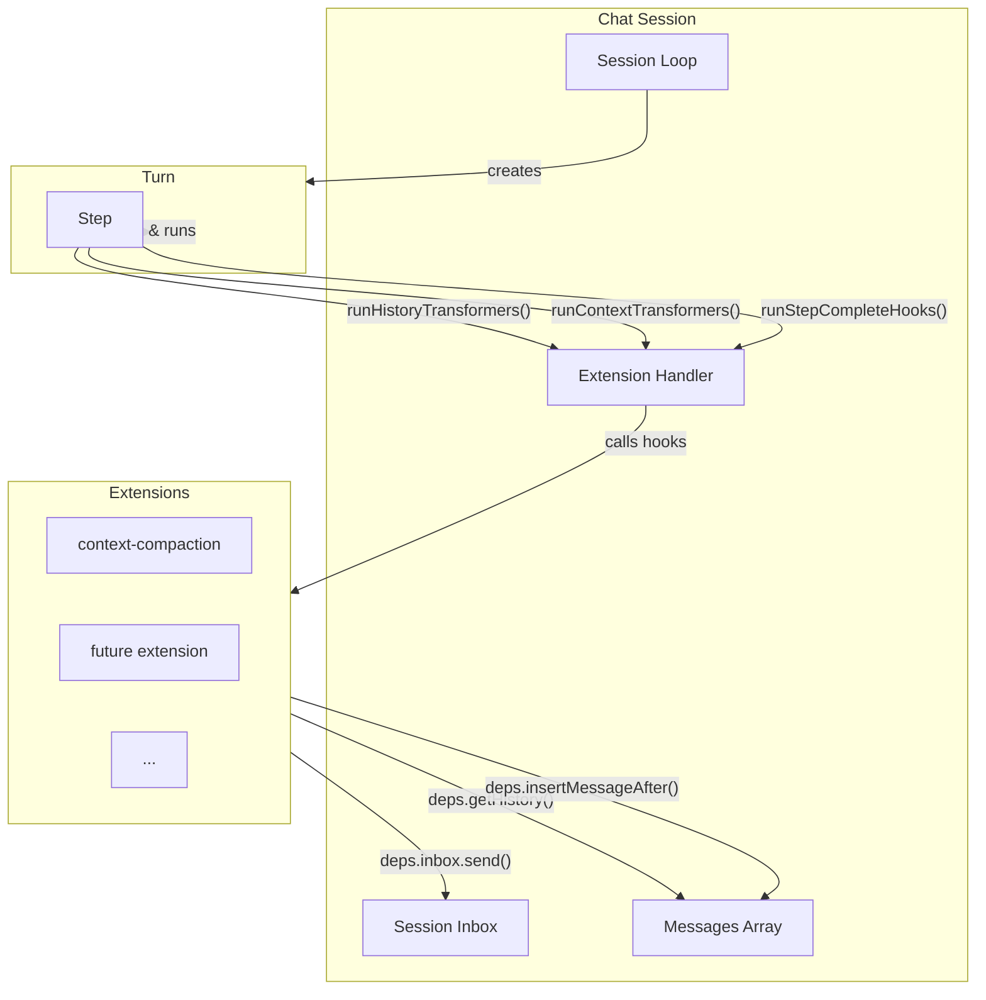
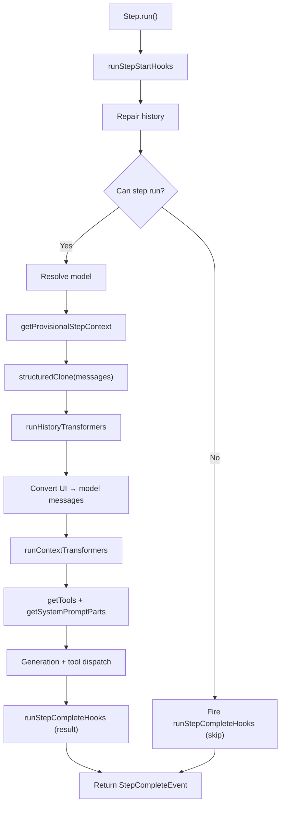

# Extension Architecture

## Overview

The extension system lets external modules observe and transform a chat session's history and context without being embedded in the core step/turn/session pipeline. The `ExtensionHandler` mediates between the session lifecycle and all loaded extensions.



The session creates the `ExtensionHandler` at construction time, passing it session-scoped dependencies. The handler instantiates each extension from its factory, augments the deps with a per-extension `getDataDir`, and exposes hook dispatchers plus a data-part transformer collector.

The handler is passed by reference through the turn to the step. The step calls the dispatchers at specific points in its pipeline. Extensions never interact with the session directly — they go through the deps the handler gave them.

## Compaction summary acceptance

Compaction renders safe transcript text and separately collects attachments from the
covered prefix. Media collection unwraps recognized SDK/MCP and JSON/error-JSON
tool envelopes, including envelopes nested by UI-to-model conversion. It does not
search arbitrary result fields or metadata for attachments.

Each summarizer candidate is attempted and validated separately, including for
text-only history. Empty responses, top-level JSON error/refusal envelopes,
standalone denial-status or ref/view control envelopes, and obvious first-person
refusal non-answers are rejected before checkpoint commit.
Provider content-filter failures remain structured failures. A rejected native
media attempt gets at most one retry for that candidate using the existing
transcription/description helpers, re-projecting the original attachments with no
native input capabilities. Rejected responses never become helper input. Failure
or cancellation of that helper path cannot authorize a checkpoint; normal
candidate/chat fallback and cancellation rules still apply. If no usable summary
is obtained, the old active window stays intact and compaction re-arms.
Audio-only models can reject text-only helper input; recovery then requires a
configured text-capable alternate. No alternate model is silently invented.
Unavailable remote media also aborts rather than authorizing a media-free trim.

The text guard is deliberately conservative and English-oriented, not a semantic
summary-quality evaluator. Quoted/historical refusals within a summary remain
valid facts; undetected or paraphrased non-answers remain a limitation. Rejection
logs contain only the model ID and reason, not generated responses or prompts.
No storage contract or checkpoint format changes are required.

## Extension identity

Every extension has a unique **identifier** in reverse-domain notation (e.g. `"io.stagewise/context-compaction"`). This is a machine-readable ID, not a human-readable label. The handler enforces uniqueness at registration time — duplicate identifiers throw before any extension is instantiated.

The optional `displayName` field covers the human-facing label shown in UIs and logs.

## Extension interface

An extension is defined by a **factory** and an **instance**:

```typescript
class MyExtension implements Extension {
  readonly identifier = 'io.example/my-extension';
  readonly displayName = 'My Extension';

  constructor(private readonly deps: ExtensionDeps) {}

  historyTransformer(history) { return history; }
  contextTransformer(history) { return history; }
  async onStepComplete(event) {}
  getCheckpointCarry(dropped) { return []; }
  async onCheckpointApplying(event) {}
  dataPartTransformers = {
    'my-custom-type': (data) => [{ type: 'text', text: data.value }],
  };
}

export const createMyExtension: ExtensionFactory = {
  identifier: 'io.example/my-extension',
  displayName: 'My Extension',
  create: (deps) => new MyExtension(deps),
};
```

All hooks are optional. An extension can implement any subset.

### Extension dependencies

| Dep | Purpose |
|-----|---------|
| `getHistory()` | Returns a copy of the current bounded window. `messages[0]` may be a checkpoint header; older messages exist only in the durable log. |
| `checkpoints.commit(request)` | Asks core to replace the window up to `coversThroughMessageId` with a header carrying `summary`. Returns `pending` or `rejected` synchronously; core applies at the next safe boundary. |
| `checkpoints.isPending(anchorId)` | True while core still holds that checkpoint as pending. When it is false and the window header does not cover the anchor, core dropped the checkpoint on re-validation and compaction re-arms without a baseline. |
| `insertMessageAfter(id, msg)` | Mutates the live history array — inserts a message after the one with the given ID. Returns `false` if not found or session is terminated. |
| `inbox` | The session inbox — send buffered messages or context events. |
| `config` | Application config. |
| `generateText(args)` | Generates text via model fallback, routed through the session for usage tracking. Returns a discriminated union — `{ success: true, text, modelId, usage }` or `{ success: false, failureReason }`. |
| `logger` | Module-scoped logger. |
| `getDataDir(global?)` | Returns a per-extension storage directory. `global=false` → session-scoped; `global=true` → agent-wide. Not guaranteed to exist — the extension must create it. |

## Data directories

| Scope | Path | When to use |
|-------|------|-------------|
| **Session-scoped** (default) | `{agentDataDir}/sessions/{sessionId}/extensions/{identifier}/` | State specific to one session. |
| **Agent-wide** (`global=true`) | `{agentDataDir}/extensions/{identifier}/` | State shared across all sessions. |

Neither directory is guaranteed to exist — the extension must create it before writing.

## Lifecycle

### One instance per session

Each session creates its own `ExtensionHandler`, which instantiates a fresh instance of every extension for that session. There is no shared extension instance across sessions. The factories themselves are singletons — defined once at application startup and passed to every `createChatSession` call. But `factory.create(deps)` is called once per session, producing a new instance each time.

### Phases

1. **Instantiation** — during `ChatSession` construction. The handler validates identifiers, builds per-extension scoped deps, and calls `factory.create()`. No hooks are called.
2. **Hook dispatch** — steady state. The session loop creates turns, turns create steps, and each step calls the handler's dispatchers at specific pipeline points. This runs for the entire lifetime of the session.
3. **Teardown** — `onClose` is called when the session closes. Extensions that hold resources (file handles, timers) should acquire them in `onStart` and release them in `onClose`. When the session terminates, `deps.insertMessageAfter()` starts returning `false`.

## Hook dispatch

The handler exposes lifecycle methods (`start`, `close`) called by the session, and pipeline dispatchers called by the step:

- `runStepStartHooks` — before history repair
- `runHistoryTransformers` — after history copy, before UI-to-model conversion
- `runContextTransformers` — after UI-to-model conversion, before generation
- `getProvisionalStepContext` — after model resolution, before the history transformation pipeline
- `getTools` / `getSystemPromptParts` — before generation, after model resolution
- `getDataPartTransformers` — during message conversion
- `runStepCompleteHooks` — after every step, including skips and cancellations

Checkpoint apply, called by core at a step boundary or while idle (see [Context window and checkpoints](../../architecture.md#context-window-and-checkpoints)):

- `collectCheckpointCarry(dropped)` — gathers `getCheckpointCarry` parts for the header
- `runCheckpointApplyingHooks(event)` — lets extensions flush or re-point state before messages leave the window



### `runHistoryTransformers(history)`

After history copy, before UI-to-model conversion. Extensions are called **sequentially** in registration order — a pipeline where each receives the output of the previous. If a transformer throws, the error is caught, logged, and re-thrown; the pipeline aborts immediately. The step catches the re-thrown error and cancels with `fatalError: true` — the session terminates gracefully because transformer failures are deterministic.

### `runContextTransformers(history)`

After UI-to-model conversion, before generation. Same sequential pipeline and error handling as history transformers, but operates on `ModelMessage[]`.

### `runStepCompleteHooks(event)`

After every step completes — skipped, cancelled, succeeded, or failed. All extensions' `onStepComplete` hooks are called **in parallel** via `Promise.allSettled`. Each receives a `structuredClone` of the event — mutations cannot leak. If a hook throws, the error is caught and logged; one extension's failure does not break other hooks. Hook errors do not cancel the step.

### `collectCheckpointCarry(dropped)`

Extensions are called **sequentially** in factory order. Each receives a `structuredClone` of the dropped messages (previous header first) and returns data parts that stand for its latest state within them; the parts are cloned into the header in the same order. If an extension throws, the error is logged and this apply aborts; the checkpoint stays pending.

### `runCheckpointApplyingHooks(event)`

Extensions are called **sequentially** in factory order with `{ droppedMessageIds, checkpointMessageId }`. A hook may return `{ defer: true }` to keep the checkpoint pending (for example, the memory extension when an episode flush failed). A throwing hook is logged and counts as a deferral. Core applies anyway after `MAX_CHECKPOINT_DEFERRALS` consecutive deferrals.

### `getDataPartTransformers()`

Called during message conversion. Iterates all extensions and merges their `dataPartTransformers` into a single map, plus the core `context-summary` renderer for checkpoint headers. If two sources register a transformer for the same data part type, the handler throws at call time — only one converter per type is allowed.

## Error isolation

| Hook type | Dispatch | One extension throws | Effect on others | Effect on step |
|-----------|----------|---------------------|-------------------|----------------|
| `historyTransformer` | Sequential pipeline | Caught, logged, re-thrown | Pipeline aborts | Step cancelled (`fatalError`) |
| `contextTransformer` | Sequential pipeline | Caught, logged, re-thrown | Pipeline aborts | Step cancelled (`fatalError`) |
| `onStepComplete` | Parallel (`allSettled`) | Caught, logged | Other hooks unaffected | No effect |
| `getCheckpointCarry` | Sequential | Caught, logged | Apply aborts | Checkpoint stays pending |
| `onCheckpointApplying` | Sequential | Caught, logged, counts as defer | Remaining hooks still run | Checkpoint deferred (forced after 3) |

**Transformer failures are fatal to the session; callback failures are contained.** Transformers are pure data transformations with no transient failure modes, so retrying identical inputs would produce the same error. Callbacks are observers — their failures must not affect control flow.
